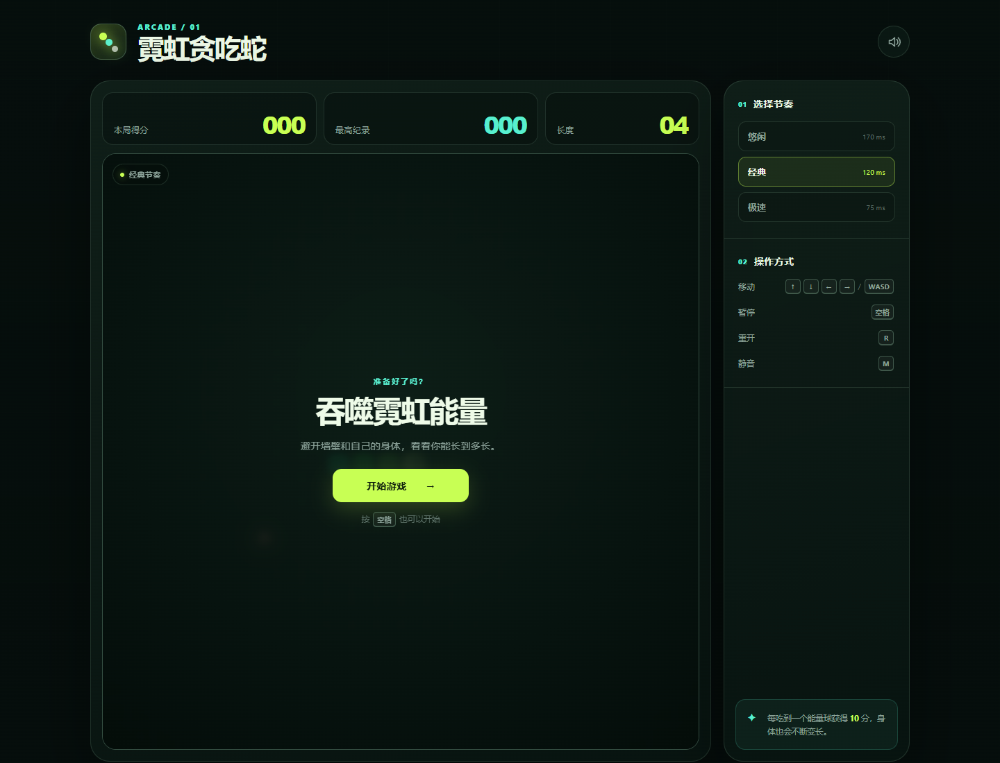

# 霓虹贪吃蛇 · Neon Snake

一款零依赖、响应式的网页版贪吃蛇游戏。支持键盘、触屏滑动与屏幕方向键，配有霓虹 Canvas 画面、三种速度、音效和本地最高分记录。



## 开始游戏

直接用浏览器打开 `index.html`，或在项目目录启动一个本地静态服务器：

```bash
npx serve .
```

也可以使用 Python：

```bash
python -m http.server 8000
```

然后访问 `http://localhost:8000`。

## 操作

| 操作 | 按键 |
| --- | --- |
| 移动 | 方向键或 `W` `A` `S` `D` |
| 暂停 / 继续 | `空格` |
| 重新开始 | `R` |
| 静音 / 取消静音 | `M` |

在手机上可以直接滑动游戏区域，或使用游戏下方的方向键。

## 功能

- 24 × 24 响应式 Canvas 棋盘
- 悠闲、经典、极速三种节奏
- 每局独立保存最高分
- Web Audio 合成音效，无需音频文件
- 键盘、滑动和触屏方向键操作
- 针对窄屏和系统“减少动态效果”设置的适配
- 纯游戏逻辑与渲染分离，附带自动化测试

## 项目结构

```text
.
├── index.html
├── styles.css
├── favicon.svg
├── src/
│   ├── game-core.js
│   └── main.js
├── tests/
│   └── game-core.test.js
└── .github/workflows/pages.yml
```

## 测试

需要 Node.js 18 或更高版本：

```bash
npm test
```

## 发布到 GitHub Pages

仓库已经包含可手动触发的 Pages 部署工作流。

1. 在仓库的 **Settings → Pages** 中将 **Source** 设为 **GitHub Actions**。
2. 打开 **Actions → Deploy to GitHub Pages**。
3. 点击 **Run workflow** 并选择 `main` 分支。

部署地址通常为 `https://<用户名>.github.io/<仓库名>/`。

## 许可证

[MIT](LICENSE)
